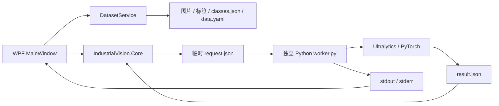

# IndustrialVision / YOLO12 开发文档

本文面向接手开发、集成 DLL、维护训练流程及部署桌面应用的开发者，基于当前仓库代码整理。

## 1. 项目定位与能力

IndustrialVision 是基于 Windows WPF、.NET 8 和 Python Ultralytics 的静态图片检测与标注工具。解决方案名称为 `IndustrialVision`，GitHub 仓库名称为 `YOLO12`。

| 能力 | 当前实现 |
| --- | --- |
| 产品检测 | 对单张图片返回类别、置信度和原图像素边框 |
| 缺陷检测 | 使用自定义缺陷模型检测整张图片 |
| 联合检测 | 先检测产品，再检测缺陷，按缺陷中心位置分配到产品 |
| 人工标注 | 绘制矩形、选择类别、删除标注、导入 YOLO 标签 |
| 数据集管理 | 保存图片、标签、有序类别表及 `data.yaml`，阻止同图跨 train/val 保存 |
| 模型训练 | 异步启动训练、输出日志、取消进程树、自动回填最佳权重 |
| 模型导出 | 导出固定输入尺寸的 ONNX 模型 |
| 结果导出 | 导出检测或联合检测 JSON |

当前没有工业相机、视频流、数据库、用户系统、HTTP 服务或免 Python 的推理实现。通用 COCO 权重不能直接识别未经训练的工业瑕疵。“未检出已知缺陷”表示当前模型与阈值下未发现已学习的缺陷，不等同于质量合格。

## 2. 环境与依赖

| 组件 | 要求 / 用途 |
| --- | --- |
| 操作系统 | Windows；WPF 项目目标为 `net8.0-windows` |
| .NET SDK | 支持构建 .NET 8 的 SDK；推荐安装 .NET 8 SDK |
| Visual Studio | VS 2022 17.8+，安装“.NET 桌面开发”工作负载 |
| Python | 推荐 3.11，当前本机使用 3.11.5 |
| Ultralytics | `8.3.203`，加载 YOLO12、检测、训练和导出 |
| ONNX 相关 | `onnx==1.19.1`、`protobuf==6.33.0`、`onnxscript==0.7.2` |
| PyTorch | 由 Python 依赖安装；CPU/CUDA 版本需与部署环境匹配 |

`requirements.txt` 固定项目直接依赖。`requirements-lock.txt` 是已有环境的依赖快照，包含传递依赖，安装脚本不会使用它；更换 Python、操作系统或 CUDA 时应重新验证兼容性。项目没有额外的 .NET 第三方 NuGet 包引用。

默认设备是 `cpu`。使用 NVIDIA GPU 时，先按 PyTorch 官方说明安装合适的 CUDA 版 PyTorch，验证 `torch.cuda.is_available()`，再在界面把设备改为 `0`。安装 CPU 版 PyTorch 时，即使有显卡也无法使用 CUDA。

## 3. 目录结构

```text
IndustrialVision.sln               解决方案：Core、Wpf、Smoke
src/
  IndustrialVision.Core/
    Models.cs                      DTO、坐标、训练参数
    VisionClient.cs                C# API、Python 进程桥接、缺陷归属
    DatasetService.cs              YOLO 标签读写、类别约束、数据隔离
  IndustrialVision.Wpf/
    App.xaml / App.xaml.cs         应用入口、异常处理、文件日志
    MainWindow.xaml                WPF 界面布局与事件绑定
    MainWindow.xaml.cs             检测、标注、训练、导出交互
backend/
  worker.py                        JSON 文件协议，执行 detect/train/export
scripts/
  download_samples.py              下载官方 COCO128 与 YOLO12n 权重
  prepare_bottles.py               提取瓶子示例、生成标签和配置
  download_parallel.py             可选的 HTTP Range 并发下载工具
  render_results.py                将检测 JSON 绘制成预览图片
tests/IndustrialVision.Smoke/       控制台冒烟验证程序
samples/
  bottles.jpg                      瓶子演示图片
  bottle-dataset/                   6 张图片的演示训练/验证集
  bottles-manifest.json             示例来源、分组和瓶子数量清单
  sources.json                     下载来源
  sha256.json                      已有下载文件的哈希记录
  COCO128-LICENSE.txt               COCO128 压缩包附带的 GPL-3.0 文本
  COCO128-README.txt                COCO128 压缩包附带的来源说明
requirements.txt                   直接 Python 依赖
requirements-lock.txt              本机 Python 环境快照
setup-python.ps1                   创建虚拟环境、安装依赖、准备示例
README.md                          快速使用说明
VALIDATION.md                      历史验证结果与限制
DEVELOPMENT.md                     本文
```

以下目录由本地安装、运行或构建生成，不上传 Git：`.venv/`、`.vs/`、`**/bin/`、`**/obj/`、`artifacts/`、`models/`、`datasets/`、`samples/coco128/`、示例压缩包及 `Ultralytics/` 本机设置。模型权重通过下载脚本获取；ONNX 可以重新导出。示例图片和小型瓶子数据集保留在仓库中，数据集缓存不提交。

## 4. 从克隆到启动

在 Windows PowerShell 中执行：

```powershell
git clone https://github.com/caotoucai/YOLO12.git
Set-Location YOLO12
python --version
dotnet --list-sdks
.\setup-python.ps1
dotnet build IndustrialVision.sln -c Release -p:UseAppHost=true
dotnet run --project src/IndustrialVision.Wpf -c Release --no-build
```

安装脚本会进入项目根目录，按需创建 `.venv`，安装 `requirements.txt`，下载官方权重与 COCO128，并重新生成瓶子数据集。下载使用 `curl.exe`，需要能访问 PyPI 和 GitHub Release。

**克隆或移动项目后需要运行安装脚本。** `prepare_bottles.py` 生成的 `samples/bottle-dataset/data.yaml` 和来源清单包含生成机器的绝对路径；重新执行脚本会更新为当前目录。已有 `.venv`、模型和完整 COCO128 时，也可只执行：

```powershell
.\.venv\Scripts\python.exe scripts/prepare_bottles.py
```

如果 PowerShell 执行策略阻止脚本，可以手动执行相同的安装步骤：

```powershell
python -m venv .venv
.\.venv\Scripts\python.exe -m pip install -r requirements.txt
.\.venv\Scripts\python.exe scripts/download_samples.py
.\.venv\Scripts\python.exe scripts/prepare_bottles.py
```

PyPI 较慢时可为 pip 安装命令指定可信镜像。下载脚本以文件大小和 ZIP 格式判断已有下载是否可复用；`sha256.json` 提供参考哈希，脚本目前不会自动校验这些哈希。

## 5. 系统架构与执行流程



`Core` 不依赖 WPF，目标为 `net8.0`，可被其他 .NET 应用引用。WPF 使用 `ProjectReference` 引用它。Core 项目会把 `backend/worker.py` 复制到构建输出的 `backend` 子目录。

一次调用的生命周期如下：

1. C# 校验输入并在系统临时目录 `IndustrialVision/<随机ID>/` 下创建请求和结果文件路径。
2. 将请求按 camelCase 序列化为 JSON，启动指定的 Python 可执行文件。
3. 通过 `ProcessStartInfo.ArgumentList` 传入 worker、请求文件和结果文件路径，不经过命令行 Shell 拼接。
4. 为该进程设置 `PYTHONUTF8=1`，将 `YOLO_CONFIG_DIR`、`MPLCONFIGDIR` 指向本次任务的临时配置目录。
5. Python 加载模型并运行；标准输出和标准错误作为日志，成功后写入结果文件。
6. C# 等待进程和日志读取完成，检查退出码及结果文件并反序列化。
7. 无论成功或失败，最终删除本次任务的临时目录。

每次 `DetectAsync`、`TrainAsync` 或 `ExportOnnxAsync` 都启动新进程并重新加载模型。`InspectAsync` 顺序执行两次检测，再在 C# 中归属缺陷。因此 `inferenceMs` 不是端到端耗时，不包含完整的进程启动和模型加载开销。

取消通过 `CancellationToken` 触发 `process.Kill(true)`，终止 Python 进程树。C# 聚合最近的输出用于异常提示；`Log` 事件可能来自后台日志读取路径，UI 订阅者需要切换到 UI 线程。当前 WPF 已使用 Dispatcher。

## 6. Core 类型与公开接口

### 6.1 数据模型

| 类型 | 关键内容 |
| --- | --- |
| `Box` | `X1, Y1, X2, Y2`，以及计算属性 `Width, Height` |
| `Detection` | `ClassId, ClassName, Confidence, Box` |
| `DetectionResult` | `ImagePath, Width, Height, Detections, InferenceMs` |
| `ProductInspection` | `Product, Defects`，计算属性 `HasDefect` |
| `InspectionResult` | `Products, Defects, Items, UnassignedDefects` |
| `Annotation` | `ClassId, Box`，不含置信度 |
| `TrainingOptions` | 模型、数据集 YAML、输出目录、轮数、尺寸、batch、设备 |
| `TrainingResult` | `BestWeights, SaveDirectory` |

边框使用**原图像素坐标**，左上角为原点，X 向右，Y 向下。检测类别 ID 由模型定义；人工标注类别 ID 由数据集的有序类别列表定义，两者不能直接假设相同。

### 6.2 VisionClient

创建实例时传入 Python 可执行文件与 `backend/worker.py` 的路径。

| 接口 | 行为与默认值 |
| --- | --- |
| `DetectAsync(model, image, confidence, device, cancellationToken)` | 返回 `DetectionResult`；默认阈值 `0.25`、设备 `cpu` |
| `InspectAsync(productModel, defectModel, image, ...)` | 分别运行两个整图模型并返回 `InspectionResult` |
| `Associate(products, defects)` | 静态方法，只执行归属计算，不调用 Python |
| `TrainAsync(options, cancellationToken)` | 返回训练得到的最佳权重路径和输出目录 |
| `ExportOnnxAsync(model, cancellationToken)` | 返回导出的 ONNX 路径 |
| `Log` | 推送 Python 标准输出和标准错误文本 |
| `JsonOptions` | camelCase、忽略读取时的属性名大小写、缩进输出 |

`DetectAsync` 要求模型和图片文件存在，置信度满足 `0 < confidence <= 1`。训练要求轮数、batch 为正整数，图片尺寸不小于 32 且为 32 的倍数，数据集 YAML 存在。Python 环境、worker 路径和模型兼容性错误可能在启动或运行阶段返回。

归属规则：取缺陷框中心点，寻找包含它的全部产品框，将缺陷归给其中面积最小的产品；找不到则加入 `UnassignedDefects`。该规则不要求整个缺陷框都在产品内，也不使用 IoU，坐标始终保留为全图坐标。

### 6.3 集成示例

在其他 .NET 8 项目中引用 Core 项目或编译后的 DLL，并准备 Python 环境及 worker：

```csharp
using IndustrialVision.Core;

var root = @"C:\apps\YOLO12";
var client = new VisionClient(
    Path.Combine(root, ".venv", "Scripts", "python.exe"),
    Path.Combine(root, "backend", "worker.py"));
client.Log += Console.WriteLine;

using var stop = new CancellationTokenSource();
var result = await client.DetectAsync(
    Path.Combine(root, "models", "yolo12n.pt"),
    Path.Combine(root, "samples", "bottles.jpg"),
    confidence: 0.25,
    device: "cpu",
    cancellationToken: stop.Token);

foreach (var detection in result.Detections)
    Console.WriteLine($"{detection.ClassName}: {detection.Confidence:F3} {detection.Box}");

var training = await client.TrainAsync(new TrainingOptions(
    Model: Path.Combine(root, "models", "yolo12n.pt"),
    DatasetYaml: Path.Combine(root, "datasets", "products", "data.yaml"),
    OutputDirectory: Path.Combine(root, "artifacts", "training"),
    Epochs: 100, ImageSize: 640, Batch: 4, Device: "cpu"), stop.Token);
Console.WriteLine(training.BestWeights);
```

`DatasetService.Save(root, imagePath, width, height, classes, annotations, validation)` 保存标注并返回目标图片路径；`Load(labelPath, width, height)` 将 YOLO 标签还原为原图像素坐标。DLL 本身不包含 Python、PyTorch 或模型权重。

## 7. C# / Python 文件协议

命令行格式：

```text
python backend/worker.py <request.json> <result.json>
```

### 7.1 detect

请求示例：

```json
{
  "command": "detect",
  "model": "C:/apps/YOLO12/models/yolo12n.pt",
  "image": "C:/apps/YOLO12/samples/bottles.jpg",
  "confidence": 0.25,
  "device": "cpu"
}
```

成功响应示例（数值仅为格式示意）：

```json
{
  "imagePath": "C:/apps/YOLO12/samples/bottles.jpg",
  "width": 428,
  "height": 640,
  "detections": [
    {
      "classId": 39,
      "className": "bottle",
      "confidence": 0.94,
      "box": { "x1": 65.6, "y1": 33.3, "x2": 150.8, "y2": 354.4 }
    }
  ],
  "inferenceMs": 100.0
}
```

worker 使用 `YOLO(model, task='detect')` 和 `model.predict(...)`，`inferenceMs` 为 Ultralytics `result.speed` 各阶段毫秒数之和。C# 导出 DTO 时还可能包含 `Box.Width/Height` 等只读计算属性。

### 7.2 train

请求字段为 `command="train"`、`model`、`data`、`output`、`epochs`、`imageSize`、`batch`、`device`。成功响应为 `{"bestWeights":".../weights/best.pt","saveDirectory":".../train"}`。

训练前 worker 检查 train 和 val 都有图片，且每张图片都有对应标签文件；负样本必须有空标签。当前验证器按 `images/train`、`images/val` 和 `labels/train`、`labels/val` 的目录约定工作，只枚举该层的 jpg/jpeg/png/bmp，不是通用的任意 YOLO YAML 数据源解析器。

训练固定参数为 `name='train'`、`exist_ok=False`、`workers=0`、`seed=42`。同一输出目录已有 `train` 时，实际目录名称由 Ultralytics 分配；调用方应使用返回的 `SaveDirectory` 和 `BestWeights`。

### 7.3 export 与错误处理

请求字段为 `command="export"` 和 `model`，成功响应是 JSON 字符串形式的 ONNX 绝对路径。当前固定 `opset=17`、`dynamic=False`、`simplify=False`、`nms=False`，导出调用未显式传入 `imgsz`。常规 YOLO12n 导出为 640 输入，使用时仍应检查实际模型输入形状。

worker 在导出进程中将 `torch.onnx.export` 绑定为 `dynamo=False`，兼容 Ultralytics 8.3 的 legacy exporter 接口。导出文件不包含内嵌 NMS；自行接入 ONNX Runtime 时还要实现正确的预处理、输出解码、NMS 和坐标还原。

worker 只在成功时写结果文件。异常通过 stderr 和非零退出码返回；Core 将最近日志拼入 `InvalidOperationException`。协议当前没有独立版本号、结构化错误码或进度事件。

## 8. 标注和数据集约定

标准目录结构：

```text
datasets/products/
  classes.json
  data.yaml
  images/train/<sha256>.jpg
  images/val/<sha256>.jpg
  labels/train/<sha256>.txt
  labels/val/<sha256>.txt
```

`classes.json` 示例为 `["can", "bottle"]`，类别 ID 分别为 0、1。创建后不允许更改类别内容或顺序；需要不同类别表时使用新目录。

每行 YOLO 标签为：

```text
class_id center_x center_y width height
```

对图片宽高 W、H 和像素边框 `(X1,Y1,X2,Y2)`，转换公式为：

```text
center_x = (X1 + X2) / (2 * W)
center_y = (Y1 + Y2) / (2 * H)
width    = (X2 - X1) / W
height   = (Y2 - Y1) / H
```

`Save` 检查图片尺寸、类别唯一性、类别 ID、有限坐标、边框正面积及边界，按图片字节的 SHA-256 命名文件，并拒绝另一集合已有同哈希标签的情况。该隔离仅适用于经 `DatasetService.Save` 管理的数据；手工复制、重编码、外部导入或示例准备脚本不受这个检查保护。

负样本应保存空标签文件。WPF 在没有标注框时要求显式勾选负样本；Core 的 `Save` 允许空标注列表。`Load` 检查每行五列并解析数字，完整类别和边界验证在保存时执行。

产品与缺陷使用不同数据集，例如 `datasets/products` 和 `datasets/defects`。产品框覆盖整个产品；缺陷框覆盖实际划痕、凹陷等区域。联合检测使用整图缺陷模型，不会先裁剪产品再检测缺陷。

演示瓶子集由 COCO128 的 bottle 类（原 ID 39）提取并映射为 ID 0，共 6 张图，4 张 train、2 张 val，仅用于流程验证。

## 9. WPF 开发说明

- `MainWindow.xaml` 定义设置、图像叠层、结果、人工标注和日志区域；业务交互集中在 code-behind，当前未使用 MVVM 框架。
- 启动时向上查找解决方案目录，优先使用该目录的 `.venv/Scripts/python.exe` 和 `models/yolo12n.pt`；worker 目录则从输出位置向上查找 `backend`。
- `SetDetectionDefaults` 设置阈值 0.25、设备 cpu 并关闭绘框。恢复预设不会清除当前图片、已有检测结果或标注。
- `Viewbox Stretch="Uniform"` 等比显示原图，`ImageSurface` 和 `Overlay` 以原图像素尺寸工作。鼠标通过 `GetPosition(Overlay)` 得到同一坐标系；绘框会限制在图像范围内，长宽至少 3 像素才保留。
- 绿色框表示检测结果，橙色表示人工标注；检测结果不会自动加入人工标签。
- `Run` 统一管理任务状态、禁用设置区、记录异常和取消；同时只允许一个 UI 任务。
- 训练始终使用上方产品模型作为初始权重。“训练缺陷模型”决定完成后回填产品模型还是缺陷模型路径；导出 ONNX 也使用此开关选择模型。
- 停止任务与关闭窗口都会请求取消当前 Python 任务。应用级未处理异常会写日志、提示错误并退出。

界面验证入口为 `--verify-ui <图片路径> <截图路径>`：加载图片后触发产品检测按钮事件，等待完成再渲染截图并关闭窗口。这能验证按钮事件路径，不能替代真实鼠标交互验收。

## 10. 构建与验证

在项目根目录执行：

```powershell
# 构建全部项目，生成可双击启动的 exe
dotnet build IndustrialVision.sln -c Release -p:UseAppHost=true

# 仅 Core 逻辑验证，不需要 Python 或模型
dotnet run --project tests/IndustrialVision.Smoke -c Release --no-build -- .

# 真实 DLL -> Python -> YOLO12 检测
dotnet run --project tests/IndustrialVision.Smoke -c Release --no-build -- . samples/bottles.jpg

# 真实检测 + 1 epoch 训练 + 重新加载权重
dotnet run --project tests/IndustrialVision.Smoke -c Release --no-build -- . samples/bottles.jpg --train

# 真实检测 + ONNX 导出
dotnet run --project tests/IndustrialVision.Smoke -c Release --no-build -- . samples/bottles.jpg --export

# 绘制最近一次瓶子检测结果
.\.venv\Scripts\python.exe scripts/render_results.py
```

Smoke 是控制台程序，不是 `dotnet test` 测试项目。第一个参数为项目根目录，第二个参数如存在即作为真实推理图片。`--train` 必须放在第三个参数位置；`--export` 则按参数集合判断。

无 Python 的逻辑验证覆盖 YOLO 标签归一化往返、禁止同图跨集合、禁止类别表变化、拒绝越界框，以及缺陷归属和未归属结果。真实推理额外检查至少一个目标、包含 bottle、坐标位于图像内，并验证图片与预测标注的序列化。预测标注只用于保存接口验证，不视为人工真值。

Smoke 输出在 `artifacts/smoke/<随机ID>/`，检测 JSON 为 `artifacts/bottle-detections.json`，训练结果在 `artifacts/training/`。训练和导出命令按需运行，不属于每次文档修改的必需步骤。

界面截图示例（将启动桌面窗口）：

```powershell
$projectRoot = (Get-Location).Path
$visionExe = Join-Path $projectRoot 'src/IndustrialVision.Wpf/bin/Release/net8.0-windows/IndustrialVision.Wpf.exe'
$image = Join-Path $projectRoot 'samples/bottles.jpg'
$screenshot = Join-Path $projectRoot 'artifacts/ui-verification.png'
New-Item -ItemType Directory -Force -Path (Join-Path $projectRoot 'artifacts') | Out-Null
& $visionExe --verify-ui $image $screenshot
```

2026-11-07 上传前复核结果记录在 `VALIDATION.md`；历史训练、界面与 ONNX 记录也保留在那里。当前没有针对真实工业瑕疵的精度验收，没有 CUDA 验证，也没有 ONNX Runtime 数值一致性验证。

## 11. 部署与日志排查

WPF Release 输出位于 `src/IndustrialVision.Wpf/bin/Release/net8.0-windows/`。当前最直接的部署方式是保留项目目录结构，在目标 Windows 机器重新建立 Python 环境、下载权重并构建。运行 framework-dependent 输出需要 .NET 8 Desktop Runtime。

仅复制 exe 不足以运行；需要配套 DLL、`.deps.json`、`.runtimeconfig.json`、worker、Python 环境、Python 依赖和模型。Python 虚拟环境不宜直接跨机器复制，应在目标机器重新创建。当前界面依赖向上查找 `IndustrialVision.sln` 来定位默认模型和工作目录；脱离项目目录部署需要额外实现明确的配置路径策略，不能假设普通 `dotnet publish` 就形成完整独立安装包。

日志写入解决方案目录的 `artifacts/logs/vision-<时间>-<进程ID>.log`；找不到解决方案时写入系统临时目录下的 `artifacts/logs/`。日志包含启动程序集位置、检测参数及完整异常，可用于识别启动旧版本、模型路径错误或 Python 执行失败。

| 现象 | 排查方向 |
| --- | --- |
| 模型不存在 | 运行安装脚本，确认 `models/yolo12n.pt`，检查界面模型路径 |
| Python 无法启动 | 检查 Python 路径；确认 `.venv/Scripts/python.exe` 存在 |
| `ModuleNotFoundError` | 用界面指定的同一个 Python 安装 requirements |
| CUDA 不可用 | 检查 PyTorch 是否为 CUDA 版、驱动兼容性和设备编号 |
| train/val 为空或标签缺失 | 检查数据集目录、重建移动后的示例路径，负样本保留空标签 |
| 类别顺序不一致 | 恢复原类别表，或创建新的数据集目录 |
| 相同图片已在另一集合 | 使用独立图片，不要绕过数据隔离来制造验证结果 |
| 联合检测没有缺陷结果 | 检查自定义缺陷权重、训练类别和阈值，确认缺陷模型适用于整图 |
| 修改代码后仍运行旧行为 | 重新构建，检查日志中的 exe/程序集路径和 Debug/Release 配置 |
| 点击检测失败或程序退出 | 读取本次会话日志中的完整异常和 Python 输出 |

## 12. 后续开发入口

| 需求 | 建议修改位置与注意事项 |
| --- | --- |
| 增加推理参数，例如 imgsz/IoU | 同步修改 `VisionClient`、worker 请求读取及 WPF 输入；保留原图坐标约定 |
| 增加新的 worker 命令 | 在 worker 增加分支，在 Core 增加 DTO 和公开方法，并验证错误及取消路径 |
| 修改缺陷归属规则 | 修改 `VisionClient.Associate`；补充嵌套产品、边界及多重匹配的行为验证 |
| 接入相机或视频 | 新增采集与帧调度模块，设计并发、背压与取消；当前每次启动进程的模式不适合低延迟逐帧处理 |
| 提高连续推理性能 | 设计常驻 Python 服务或 ONNX Runtime 后端，区分模型时间与端到端时间 |
| 裁剪产品后检测缺陷 | 重新定义模型训练输入与推理流程，并将裁剪坐标映射回原图 |
| 发布独立安装包 | 增加工作目录、Python、模型路径的配置机制及依赖安装流程 |
| 拆分 UI 职责 | 从 `MainWindow.xaml.cs` 提取任务服务、标注状态和 ViewModel |

修改数据集行为时应保留类别顺序不变、负样本标签明确、train/val 独立的约束。修改推理后端时要验证坐标还原、类别映射、置信度、取消和日志行为，而不仅检查模型能否加载。

## 13. 仓库维护与第三方来源

```powershell
git status
git add <修改的文件>
git diff --cached
git commit -m "Describe the change"
git push origin main
```

不提交本机环境、运行产物、密钥或业务训练数据。新增示例时保留来源和使用条件；大规模训练集与权重应另行管理，仓库保留获取方式和必要的版本记录。

样本与权重官方来源见 `samples/sources.json`，YOLO12 说明见 <https://docs.ultralytics.com/zh/models/yolo12/>。COCO 图片采用原始来源的使用条件，标签来自 COCO128；原始压缩包附带的 GPL-3.0 文本和说明保留为 `samples/COCO128-LICENSE.txt`、`samples/COCO128-README.txt`。Ultralytics/YOLO12 涉及 AGPL-3.0 或商业授权，部署与分发应遵守适用条款。当前仓库没有为项目自身单独声明开源许可证。
